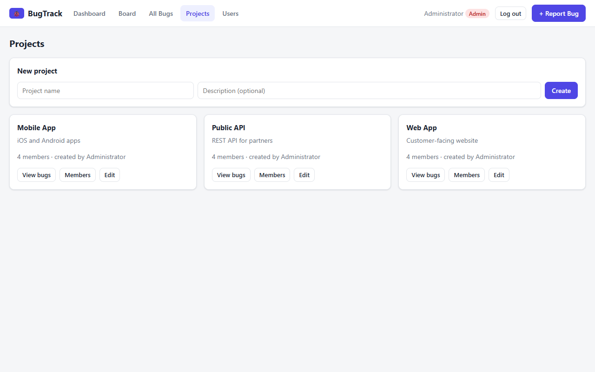
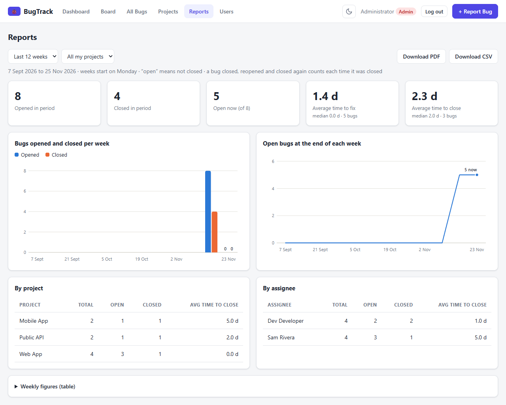

# BugTrack – Bug Tracking and Management System

[](https://github.com/lakshmineha1234/bug-tracking-system/actions/workflows/ci.yml)

A web application for software teams to report, assign, track and resolve bugs.
Testers report defects, admins manage projects and assignments, and developers work on the bugs assigned to them.


## Screenshots

### Board
Bugs grouped by status. Cards can be dragged to another column, but only moves the user's role allows are accepted.


### All bugs
Search by ID, title or description, and filter by status, priority, severity, project and assignee. Columns are sortable and the list can be exported to CSV.


### Bug details
Each report records the description, steps to reproduce, expected result and actual result, with priority and severity as separate fields.


### Workflow, comments and history
The status buttons shown depend on the user's role and the bug's current status. Admins assign the bug to a developer in the project. Every status change is recorded.


### Projects
Admins create projects and manage their members. Testers and developers see only the projects they belong to.



### Reports
Trends over the last 4 to 52 weeks, time to fix and close, and breakdowns by project and assignee, with PDF and CSV export.



### Dark mode
The interface follows the operating system's light or dark setting by default. The sun/moon button in the header switches theme, and the choice is remembered in the browser.


### Sign in


## Features

- Registration and login with BCrypt-hashed passwords and session-based authentication
- Users change their own password (click your name in the header); admins can reset a user's password, and the account owner is emailed whenever their password changes
- Role-based access (Admin, Tester, Developer), enforced in the backend
- Projects with members; testers see their projects' bugs, developers see bugs assigned to them
- Bug reports with description, steps to reproduce, expected and actual results, priority and severity
- Assignment to developers who are members of the bug's project
- Controlled status workflow, with a history of every status change and every assignment change
- Comments on bugs
- Dashboard: counts by status, priority, severity, project and assignee, plus recent activity
- Search and filters (keyword, status, priority, severity, project, assignee), Kanban board, CSV export
- Email notifications when a bug is assigned, marked fixed, returned, closed, reopened or commented on, each with a link that opens the bug
- File attachments on bugs (screenshots, PDFs, logs, CSV, JSON, ZIP; up to 10 MB each) with image previews
- Reports: weekly opened/closed trend, open backlog, time to fix and close, breakdowns by project and assignee, with PDF and CSV export
- Light and dark themes, with a toggle in the header

## User roles

| Role | Can do |
|---|---|
| Admin | Manage users (role, active/disabled) and projects (create, edit, members); see all bugs; assign bugs; any status transition |
| Tester | Report bugs in their projects; edit bugs they reported; comment; verify fixes (close, or return to the developer); reopen closed bugs |
| Developer | See bugs assigned to them; comment; start work; mark fixes ready for testing |

New users register as Tester or Developer. Admin accounts cannot be self-registered: the first admin is created at startup from environment variables (see below), and admins can promote other users.

## Bug lifecycle

| From | To | Who |
|---|---|---|
| OPEN | IN_PROGRESS | Assigned developer |
| IN_PROGRESS | FIXED | Assigned developer |
| FIXED | CLOSED | Tester (fix verified) |
| FIXED | IN_PROGRESS | Tester (fix failed retest, returned to developer) |
| CLOSED | OPEN | Tester (reopen) |

Admins may perform any of these transitions. Every transition is recorded in `bug_history`, and every change of assignee (assigned, reassigned or unassigned) in `assignment_history`. The bug details show both as one timeline.

## Technology stack

Java 21+, Spring Boot 3.5 (Web, Data JPA, Security, Validation, Mail), Flyway, OpenPDF (PDF reports), MySQL 8, HTML/CSS/JavaScript, Maven, JUnit 5, Mockito, Spring Boot Test (H2 for tests).

## Prerequisites

- JDK 21 or later (for example Eclipse Temurin 21), with `JAVA_HOME` set
- MySQL Server 8.x running locally
- Maven is **not** required: the included wrapper (`mvnw.cmd` / `mvnw`) downloads it on first use

## Database setup

```sql
CREATE DATABASE bug_tracking_db;
```

The tables (`users`, `projects`, `project_members`, `bugs`, `comments`, `bug_history`, `assignment_history`, `attachments`) are created on first start by [Flyway](https://documentation.red-gate.com/flyway) migrations in `src/main/resources/db/migration`. Flyway records what it has applied in `flyway_schema_history`, and Hibernate only checks that the tables match the entities (`ddl-auto=validate`).

To change the schema, add a new file such as `V3__add_attachments.sql`; never edit a migration that has already been applied. A database created before migrations were introduced is detected automatically, marked as version 1, and then upgraded.

## Configuration

Settings are read from environment variables, so no secrets are stored in the code.

| Variable | Default | Purpose |
|---|---|---|
| `DB_URL` | `jdbc:mysql://localhost:3306/bug_tracking_db` | JDBC URL |
| `DB_USERNAME` | `root` | Database user |
| `DB_PASSWORD` | *(empty)* | Database password |
| `BUGTRACK_ADMIN_EMAIL` | *(none)* | Email of the first admin, created if no admin exists |
| `BUGTRACK_ADMIN_PASSWORD` | *(none)* | Password of the first admin (at least 8 characters) |
| `BUGTRACK_ADMIN_NAME` | `Administrator` | Display name of the first admin |
| `MAIL_ENABLED` | `false` | Send email notifications. When `false`, emails are written to the log instead |
| `MAIL_HOST` / `MAIL_PORT` | `localhost` / `587` | SMTP server |
| `MAIL_USERNAME` / `MAIL_PASSWORD` | *(empty)* | SMTP login |
| `MAIL_SMTP_AUTH` / `MAIL_STARTTLS` | `false` / `false` | Set both to `true` for most hosted mail services |
| `MAIL_FROM` | `BugTrack <no-reply@bugtrack.local>` | Sender address |
| `APP_BASE_URL` | `http://localhost:8080` | Address used for links in emails |
| `REGISTRATION_ENABLED` | `true` | Allow public sign-up. Set to `false` for invitation-only: admins then add users on the Users page |
| `SPRING_PROFILES_ACTIVE` | *(none)* | `prod` turns on the production settings (secure cookies, HTTPS behind a proxy, attachments in `/data`). The Docker image sets it |
| `ATTACHMENTS_DIR` | `data/attachments` | Folder where attachment files are stored (relative to the folder the app starts in) |

### Email notifications

BugTrack emails the people involved when a bug changes:

| Change | Who is emailed |
|---|---|
| Assigned or reassigned | The developer it is assigned to (with the bug's full details) |
| Marked fixed | The tester who reported it, to retest |
| Returned (fix failed retest) | The assigned developer |
| Verified and closed | The assigned developer |
| Reopened | The assigned developer |
| New comment | The reporter and the assigned developer |

Nobody is emailed about their own action, disabled accounts and people who can no longer see the bug are skipped, and nobody gets the same email twice. Each email links to the bug, for example `http://localhost:8080/#bug-8`, which opens it after signing in.

Emails are sent in the background after the change is saved, one at a time in the order the changes happened. A failed send is retried twice (after 2 and 5 seconds); if it still fails, the change itself is unaffected and the failure is logged.

Example for Gmail (create an [app password](https://support.google.com/accounts/answer/185833) first), in `application-local.properties`:

```properties
app.mail.enabled=true
spring.mail.host=smtp.gmail.com
spring.mail.port=587
spring.mail.username=your.address@gmail.com
spring.mail.password=your-app-password
spring.mail.properties.mail.smtp.auth=true
spring.mail.properties.mail.smtp.starttls.enable=true
app.mail.from=BugTrack <your.address@gmail.com>
```

To try it without a real mail account, run Python's test mail server (Python 3.11 or earlier), which prints every email it receives, and point the app at it with `spring.mail.host=127.0.0.1`, `spring.mail.port=1025` and `app.mail.enabled=true`:

```
python -m smtpd -n -c DebuggingServer 127.0.0.1:1025
```

## Running

Quick start on Windows: copy `application-local.properties.example` to `application-local.properties` in the project folder and fill in your database password and first admin account (the copy is git-ignored, so your passwords stay local), then double-click:

| File | What it does |
|---|---|
| `start.cmd` | Starts MySQL (unless it is already running), the test mail server (only if your local settings use it) and the app, then opens http://localhost:8080. Each runs in its own minimized window, where you can see its log. Anything already running is left alone. |
| `stop.cmd` | Stops the app and the test mail server, and shuts MySQL down cleanly. A MySQL Windows service is left running (add `-IncludeService` to stop it too). |
| `install-mysql-service.cmd` | Optional, **run as administrator**: registers MySQL as the Windows service `BugTrackMySQL`, so the database starts with Windows. Add `-Remove` to unregister it; the data is not touched. |

`start.cmd` expects MySQL's data folder at `%USERPROFILE%\.bugtrack-mysql` and MySQL Server under `C:\Program Files\MySQL`. The lower-level `start-mysql.cmd` and `run.cmd` still work on their own.

Or with environment variables in PowerShell:

```powershell
$env:DB_PASSWORD = "your-mysql-password"
$env:BUGTRACK_ADMIN_EMAIL = "admin@example.com"
$env:BUGTRACK_ADMIN_PASSWORD = "choose-a-strong-password"
.\mvnw.cmd spring-boot:run
```

Then open http://localhost:8080 and sign in as the admin. The backend serves the frontend, so there is nothing separate to start.

Suggested first steps: create a project, have a tester and a developer register, add them to the project (Projects → Members), report a bug as the tester, assign it as the admin, then work it through the lifecycle.

## Reports

The **Reports** page covers the last 4, 12, 26 or 52 weeks, for all your projects or one of them, using the same access rules as the rest of the app:

- **Headline figures:** bugs opened and closed in the period, bugs open now, and the average and median time to fix (report to first marked fixed) and to close (report to closed)
- **Charts:** bugs opened vs closed per week, and the open backlog at the end of each week, with hover details
- **Tables:** totals, open, closed and average time to close by project and by assignee, plus the weekly figures
- **Export:** a PDF report generated on the server (figures, chart and tables) and a CSV of the weekly figures

Weeks start on Monday. "Open" means not closed (open, in progress, or fixed and awaiting testing). A bug that is closed, reopened and closed again counts each time it was closed in the weekly figures.

## Attachments

Anyone who can see a bug can view, download and add attachments; only the uploader or an admin can delete one. Allowed types are PNG, JPG, GIF, WebP, PDF, TXT, LOG, CSV, JSON and ZIP, up to 10 MB each. The type is checked from the file's contents, not only its name, so a renamed file is refused, and types a browser could run as a page (such as HTML or SVG) are never accepted. Only images are shown in the browser; everything else is downloaded.

Files are stored on disk in `ATTACHMENTS_DIR` under random names, while the database keeps their names, sizes and uploaders. **Back up that folder together with the database.**

## API summary

| Method | Endpoint | Purpose |
|---|---|---|
| GET | `/api/auth/csrf` | Get the CSRF token to send on state-changing requests |
| POST | `/api/auth/register` | Register (Tester or Developer) |
| POST | `/api/auth/login` | Log in (starts a session) |
| POST | `/api/auth/logout` | Log out |
| GET | `/api/auth/me` | Current user |
| POST | `/api/auth/password` | Change your own password (`currentPassword`, `newPassword`) |
| GET | `/api/users` | List users (admin) |
| PATCH | `/api/users/{id}` | Change a user's role or active status (admin) |
| POST | `/api/users` | Create a user with any role (admin) |
| PUT | `/api/users/{id}/password` | Set a new password for a user (admin) |
| GET | `/api/projects` | Projects visible to the current user |
| POST | `/api/projects` | Create a project (admin) |
| PUT | `/api/projects/{id}` | Edit a project (admin) |
| GET | `/api/projects/{id}/members` | List project members |
| POST / DELETE | `/api/projects/{id}/members/{userId}` | Add / remove a member (admin) |
| GET | `/api/bugs` | List accessible bugs, one page at a time (see below). Filters: `q`, `status`, `priority`, `severity`, `projectId`, `assigneeId`, `unassigned=true` |
| GET | `/api/bugs/{id}` | Get one bug |
| POST | `/api/bugs` | Report a bug (tester, admin) |
| PUT | `/api/bugs/{id}` | Edit bug details (reporter, admin) |
| PATCH | `/api/bugs/{id}/status` | Change status (see lifecycle) |
| PATCH | `/api/bugs/{id}/assignment` | Assign or unassign (admin) |
| GET / POST | `/api/bugs/{id}/comments` | List / add comments |
| GET | `/api/bugs/{id}/history` | Status history |
| GET | `/api/bugs/{id}/assignments` | Assignment history (assigned, reassigned, unassigned) |
| GET | `/api/bugs/{id}/attachments` | List a bug's attachments |
| POST | `/api/bugs/{id}/attachments` | Upload one file (multipart form field `file`) |
| GET | `/api/attachments/{id}` | Download a file (`?inline=true` shows an image in the browser) |
| DELETE | `/api/attachments/{id}` | Delete an attachment (uploader or admin) |
| GET | `/api/dashboard/summary` | Dashboard statistics |
| GET | `/api/reports` | Report data. `weeks` (4–52, default 12), optional `projectId` |
| GET | `/api/reports/pdf` | The same report as a PDF download |

`GET /api/bugs` returns one page: `{content, page, size, totalElements, totalPages}`. Paging and sorting parameters:

| Parameter | Default | Values |
|---|---|---|
| `page` | `0` | Zero-based page number |
| `size` | `20` | 1–100 |
| `sort` | `id` | `id`, `title`, `project`, `status`, `priority`, `severity`, `assignee`, `updatedAt` |
| `dir` | `desc` | `asc` or `desc` |

Status, priority and severity sort by importance, not alphabetically: `sort=priority&dir=asc` lists Critical first. Example: `GET /api/bugs?status=OPEN&sort=priority&dir=asc&page=0&size=50`.

Errors are returned as JSON: `{timestamp, status, error, message, fieldErrors}`.

To call the API from Postman: `GET /api/auth/csrf`, then send the token in the `X-CSRF-TOKEN` header on every POST/PUT/PATCH/DELETE (Postman keeps the session cookie).

## Deploying

BugTrack ships as a Docker image (`Dockerfile`) that runs the production settings in `src/main/resources/application-prod.properties`. It needs a MySQL 8 database, a persistent disk for attachments, and HTTPS in front of it. The health check is at `/actuator/health`.

Every push is checked by GitHub Actions: besides the tests, it builds the image and runs it against a MySQL 8.4 database to confirm the app starts, applies its migrations and serves the page.

### Railway, step by step

[Railway](https://railway.com) runs Docker images and offers MySQL and persistent disks. It is not free: new accounts get a trial credit, then the Hobby plan is about $5/month (check their pricing page).

1. **Create a project from this repository.** In Railway: *New Project → Deploy from GitHub repo* → choose your copy of this repository. Railway finds the `Dockerfile` and builds it. The first deploy will fail until steps 2–4 are done; that is expected.
2. **Add the database.** In the project: *New → Database → MySQL*. Keep the service name `MySQL` (the variables below refer to it). Recommended: in the MySQL service's settings, set its source image to `mysql:8.4`, the version BugTrack is tested with.
3. **Set the app's variables** (app service → *Variables*). The `${{...}}` references are filled in by Railway:

   | Variable | Value |
   |---|---|
   | `DB_URL` | `jdbc:mysql://${{MySQL.MYSQLHOST}}:${{MySQL.MYSQLPORT}}/${{MySQL.MYSQLDATABASE}}` |
   | `DB_USERNAME` | `${{MySQL.MYSQLUSER}}` |
   | `DB_PASSWORD` | `${{MySQL.MYSQLPASSWORD}}` |
   | `BUGTRACK_ADMIN_EMAIL` | the first admin's email |
   | `BUGTRACK_ADMIN_PASSWORD` | a strong password (at least 8 characters) for that admin |
   | `APP_BASE_URL` | `https://${{RAILWAY_PUBLIC_DOMAIN}}` (used for links in emails) |
   | `REGISTRATION_ENABLED` | `false` to make accounts invitation-only (recommended for a public site) |
   | `RAILWAY_RUN_UID` | `0`. Railway mounts disks as the root user, and the app's image runs as a non-root user, so without this setting attachments cannot be saved |

4. **Add a disk for attachments.** App service → *Volumes* (or right-click the service → *Attach volume*), mount path **`/data`**.
5. **Make it reachable.** App service → *Settings → Networking → Generate domain*, target port **8080**.
6. **Health check.** App service → *Settings → Deploy → Healthcheck path*: `/actuator/health`.
7. **Deploy** (or redeploy). Open the generated `https://….up.railway.app` address and sign in as the admin from step 3. Then create projects and add users on the Users page.

**Email (optional).** Without mail settings, notification emails are only written to the app's log. To send real email, also set `MAIL_ENABLED=true`, `MAIL_HOST`, `MAIL_PORT`, `MAIL_USERNAME`, `MAIL_PASSWORD`, `MAIL_SMTP_AUTH=true`, `MAIL_STARTTLS=true` and `MAIL_FROM` (see [Email notifications](#email-notifications); for Gmail, use an app password).

**Backups.** The database and the attachments disk hold all your data. Use Railway's backup options for both, or your own `mysqldump`.

### Other hosts

Any host that runs Docker images works the same way: set the `DB_*`, `BUGTRACK_ADMIN_*` and `APP_BASE_URL` variables, mount persistent storage at `/data`, put HTTPS in front, and point the health check at `/actuator/health`. The app listens on port 8080, or on `PORT` if the host sets it.

## Running the tests

```powershell
.\mvnw.cmd test
```

Tests use an in-memory H2 database, so MySQL is not needed. `BugApiIntegrationTest` covers test cases TC-01 to TC-08 from the project documentation, plus permission rules; `BugWorkflowTest` and `BugServiceTest` are unit tests of the workflow and service logic.

## Project structure

```
bug-tracking-system/
├── pom.xml, mvnw, mvnw.cmd, .mvn/wrapper/
└── src/
    ├── main/java/com/bugtracker/
    │   ├── BugTrackingApplication.java
    │   ├── config/        SecurityConfig, AdminInitializer
    │   ├── controller/    Auth, Bug, Project, User, Dashboard controllers
    │   ├── dto/           Request and response records
    │   ├── entity/        JPA entities and enums
    │   ├── exception/     API exceptions and the global handler
    │   ├── repository/    Spring Data JPA repositories
    │   ├── security/      User details, current-user lookup
    │   └── service/       Business logic, permissions, workflow
    ├── main/resources/
    │   ├── application.properties
    │   ├── db/migration/  Flyway migrations (V1__initial_schema.sql, V2__assignment_history.sql, V3__attachments.sql)
    │   └── static/        index.html, style.css, script.js
    └── test/              Unit and integration tests
```

## Known limitations and future improvements

- No CORS configuration is needed because the backend serves the frontend from the same origin. If the frontend is ever hosted separately, allow only that origin.
- Not yet implemented: sprints/releases, GitHub integration, and a self-service "forgot password" email (an admin resets forgotten passwords instead).
- There is no limit on repeated sign-in attempts; on a public site, consider adding rate limiting.
- PDF reports use the standard Helvetica font, which covers Western European characters only; names in other scripts would not print correctly.
