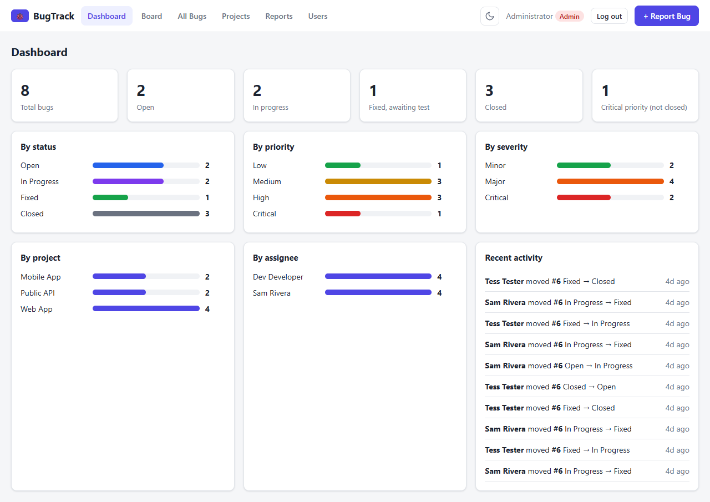
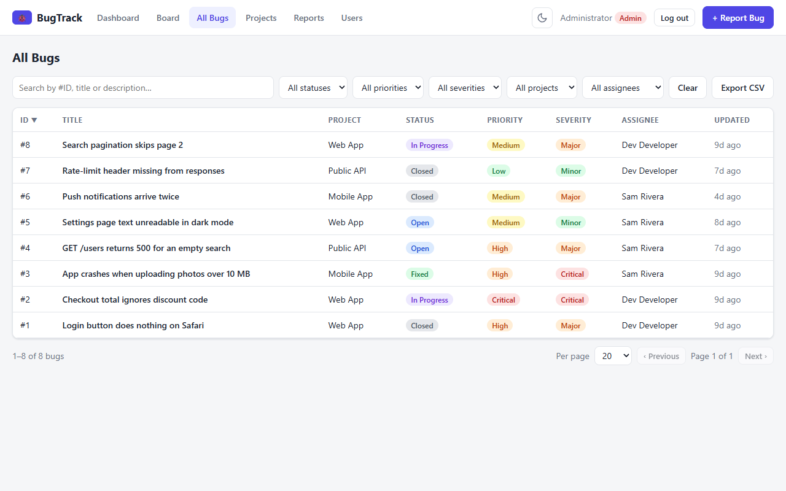
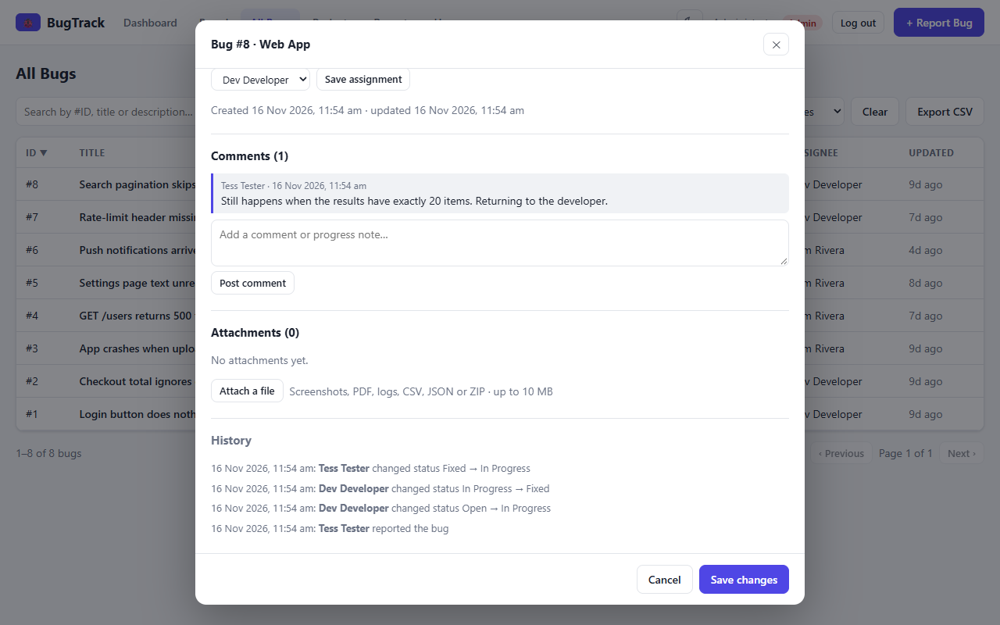
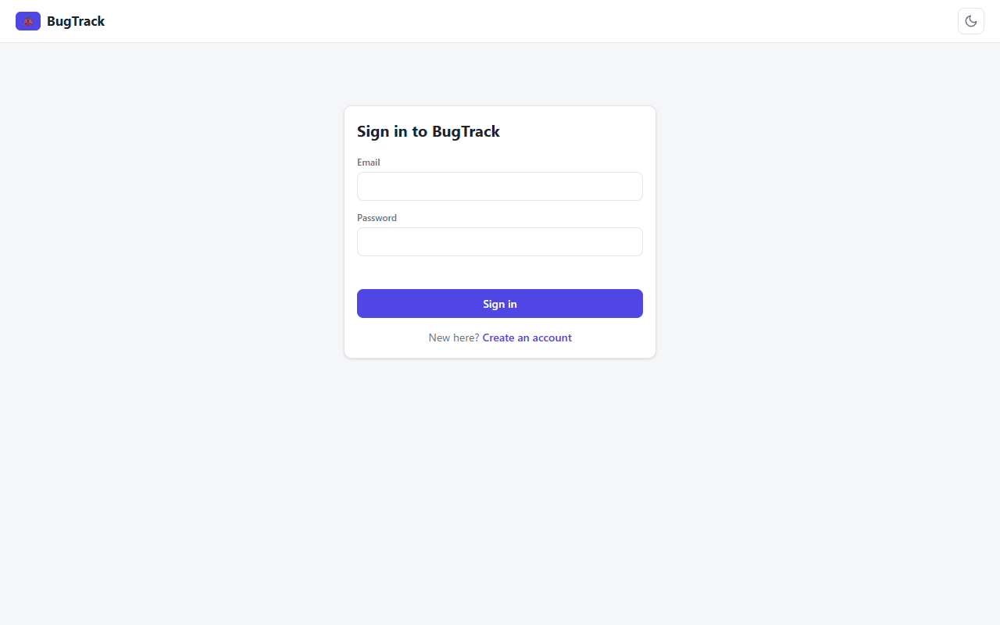

# BugTrack – Bug Tracking and Management System

A web application for software teams to report, assign, track and resolve bugs.
Testers report defects, admins manage projects and assignments, and developers work on the bugs assigned to them.



## Screenshots

### Board
Bugs grouped by status. Cards can be dragged to another column, but only moves the user's role allows are accepted.


### All bugs
Search by ID, title or description, and filter by status, priority, severity, project and assignee. Columns are sortable and the list can be exported to CSV.



### Bug details
Each report records the description, steps to reproduce, expected result and actual result, with priority and severity as separate fields.


### Workflow, comments and history
The status buttons shown depend on the user's role and the bug's current status. Admins assign the bug to a developer in the project. Every status change is recorded.



### Projects
Admins create projects and manage their members. Testers and developers see only the projects they belong to.


### Dark mode
The interface follows the operating system's light or dark setting automatically.


### Sign in


## Features

- Registration and login with BCrypt-hashed passwords and session-based authentication
- Role-based access (Admin, Tester, Developer), enforced in the backend
- Projects with members; testers see their projects' bugs, developers see bugs assigned to them
- Bug reports with description, steps to reproduce, expected and actual results, priority and severity
- Assignment to developers who are members of the bug's project
- Controlled status workflow with a recorded history of every status change
- Comments on bugs
- Dashboard: counts by status, priority, severity, project and assignee, plus recent activity
- Search and filters (keyword, status, priority, severity, project, assignee), Kanban board, CSV export

## User roles

| Role | Can do |
|---|---|
| Admin | Manage users (role, active/disabled) and projects (create, edit, members); see all bugs; assign bugs; any status transition |
| Tester | Report bugs in their projects; edit bugs they reported; comment; verify fixes (close, or return to the developer); reopen closed bugs |
| Developer | See bugs assigned to them; comment; start work; mark fixes ready for testing |

New users register as Tester or Developer. Admin accounts cannot be self-registered: the first admin is created at startup from environment variables (see below), and admins can promote other users.

## Bug lifecycle

| From | To | Who |
|---|---|---|
| OPEN | IN_PROGRESS | Assigned developer |
| IN_PROGRESS | FIXED | Assigned developer |
| FIXED | CLOSED | Tester (fix verified) |
| FIXED | IN_PROGRESS | Tester (fix failed retest, returned to developer) |
| CLOSED | OPEN | Tester (reopen) |

Admins may perform any of these transitions. Every transition is recorded in `bug_history`.

## Technology stack

Java 17+, Spring Boot 3.3 (Web, Data JPA, Security, Validation), MySQL 8, HTML/CSS/JavaScript, Maven, JUnit 5, Mockito, Spring Boot Test (H2 for tests).

## Prerequisites

- JDK 17 or later (for example Eclipse Temurin 21), with `JAVA_HOME` set
- MySQL Server 8.x running locally
- Maven is **not** required: the included wrapper (`mvnw.cmd` / `mvnw`) downloads it on first use

## Database setup

```sql
CREATE DATABASE bug_tracking_db;
```

Tables (`users`, `projects`, `project_members`, `bugs`, `comments`, `bug_history`) are created automatically on first start.

## Configuration

Settings are read from environment variables, so no secrets are stored in the code.

| Variable | Default | Purpose |
|---|---|---|
| `DB_URL` | `jdbc:mysql://localhost:3306/bug_tracking_db` | JDBC URL |
| `DB_USERNAME` | `root` | Database user |
| `DB_PASSWORD` | *(empty)* | Database password |
| `BUGTRACK_ADMIN_EMAIL` | *(none)* | Email of the first admin, created if no admin exists |
| `BUGTRACK_ADMIN_PASSWORD` | *(none)* | Password of the first admin (at least 8 characters) |
| `BUGTRACK_ADMIN_NAME` | `Administrator` | Display name of the first admin |

## Running

Quick start on Windows: put your settings in `application-local.properties` in the project folder (git-ignored; same keys as `src/main/resources/application.properties`, for example `spring.datasource.password=...` and `app.admin.email=...`), then:

1. `start-mysql.cmd` if MySQL is not already running as a service (uses a data folder under `%USERPROFILE%\.bugtrack-mysql`)
2. `run.cmd` to start the app on http://localhost:8080

Or with environment variables in PowerShell:

```powershell
$env:DB_PASSWORD = "your-mysql-password"
$env:BUGTRACK_ADMIN_EMAIL = "admin@example.com"
$env:BUGTRACK_ADMIN_PASSWORD = "choose-a-strong-password"
.\mvnw.cmd spring-boot:run
```

Then open http://localhost:8080 and sign in as the admin. The backend serves the frontend, so there is nothing separate to start.

Suggested first steps: create a project, have a tester and a developer register, add them to the project (Projects → Members), report a bug as the tester, assign it as the admin, then work it through the lifecycle.

## API summary

| Method | Endpoint | Purpose |
|---|---|---|
| GET | `/api/auth/csrf` | Get the CSRF token to send on state-changing requests |
| POST | `/api/auth/register` | Register (Tester or Developer) |
| POST | `/api/auth/login` | Log in (starts a session) |
| POST | `/api/auth/logout` | Log out |
| GET | `/api/auth/me` | Current user |
| GET | `/api/users` | List users (admin) |
| PATCH | `/api/users/{id}` | Change a user's role or active status (admin) |
| GET | `/api/projects` | Projects visible to the current user |
| POST | `/api/projects` | Create a project (admin) |
| PUT | `/api/projects/{id}` | Edit a project (admin) |
| GET | `/api/projects/{id}/members` | List project members |
| POST / DELETE | `/api/projects/{id}/members/{userId}` | Add / remove a member (admin) |
| GET | `/api/bugs` | List accessible bugs. Filters: `q`, `status`, `priority`, `severity`, `projectId`, `assigneeId`, `unassigned=true` |
| GET | `/api/bugs/{id}` | Get one bug |
| POST | `/api/bugs` | Report a bug (tester, admin) |
| PUT | `/api/bugs/{id}` | Edit bug details (reporter, admin) |
| PATCH | `/api/bugs/{id}/status` | Change status (see lifecycle) |
| PATCH | `/api/bugs/{id}/assignment` | Assign or unassign (admin) |
| GET / POST | `/api/bugs/{id}/comments` | List / add comments |
| GET | `/api/bugs/{id}/history` | Status history |
| GET | `/api/dashboard/summary` | Dashboard statistics |

Errors are returned as JSON: `{timestamp, status, error, message, fieldErrors}`.

To call the API from Postman: `GET /api/auth/csrf`, then send the token in the `X-CSRF-TOKEN` header on every POST/PUT/PATCH/DELETE (Postman keeps the session cookie).

## Running the tests

```powershell
.\mvnw.cmd test
```

Tests use an in-memory H2 database, so MySQL is not needed. `BugApiIntegrationTest` covers test cases TC-01 to TC-08 from the project documentation, plus permission rules; `BugWorkflowTest` and `BugServiceTest` are unit tests of the workflow and service logic.

## Project structure

```
bug-tracking-system/
├── pom.xml, mvnw, mvnw.cmd, .mvn/wrapper/
└── src/
    ├── main/java/com/bugtracker/
    │   ├── BugTrackingApplication.java
    │   ├── config/        SecurityConfig, AdminInitializer
    │   ├── controller/    Auth, Bug, Project, User, Dashboard controllers
    │   ├── dto/           Request and response records
    │   ├── entity/        JPA entities and enums
    │   ├── exception/     API exceptions and the global handler
    │   ├── repository/    Spring Data JPA repositories
    │   ├── security/      User details, current-user lookup
    │   └── service/       Business logic, permissions, workflow
    ├── main/resources/
    │   ├── application.properties
    │   └── static/        index.html, style.css, script.js
    └── test/              Unit and integration tests
```

## Known limitations and future improvements

- The schema is managed by Hibernate (`ddl-auto=update`). Switch to Flyway or Liquibase migrations before production.
- No CORS configuration is needed because the backend serves the frontend from the same origin. If the frontend is ever hosted separately, allow only that origin.
- Not yet implemented: file attachments, email notifications, sprints/releases, PDF reports, GitHub integration, pagination of bug lists.
